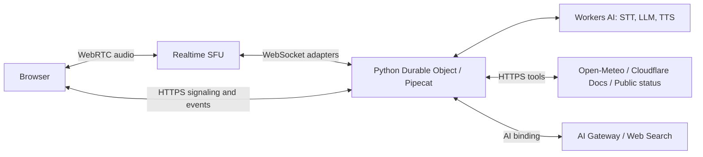

# Pipecat voice agent

> Example status: **Experimental**

A browser voice agent built with Cloudflare Workers, Realtime SFU, and Pipecat. The interface uses React 19 and Tailwind CSS 4.

You can interrupt the agent while it's talking, and it remembers facts you give it during the call. Settings let you change its name, voice, and instructions, and turn on tools for the current time, [weather and forecasts](https://open-meteo.com/), [Cloudflare documentation](https://developers.cloudflare.com/agents/model-context-protocol/cloudflare/servers-for-cloudflare/), [public service status](https://www.cloudflarestatus.com/), and [web search](https://developers.cloudflare.com/web-search/). Transcripts, tool status, and source links appear in the conversation.

## Architecture

Each call runs in a Python Durable Object. Workers AI handles speech recognition, turn detection, language generation, and speech synthesis, and the SFU carries the audio.



## Try it

Preview the interface with the Node.js version in [.nvmrc](.nvmrc):

```sh
cd pipecat-voice-agent
npm ci
npm run dev
```

Open `http://127.0.0.1:5173`. The preview uses sample conversations and needs no credentials or microphone. To make real calls, follow the [deployment guide](docs/deployment.md).

A headset helps with interruptions because it keeps the assistant's voice out of your microphone.

## Known limitations

- Calls don't resume after a Worker restart or a browser disconnect, and each call starts with a fresh conversation history.
- Everyone signs in with one shared access code. Use an [identity provider](docs/authentication.md) for individual access and revocation.
- The SFU must reach the `/media/` adapter endpoints without a login challenge, so accounts that require Cloudflare Access on every endpoint can't host it.
- The default model requires Workers Paid, and Web Search needs its own AI Gateway payment setup.
- The bundled Pipecat build relies on hosted AI services and Flux turn detection; local VAD and Smart Turn aren't available. See [package compatibility](vendor/README.md).

## Guides

| Task                                | Guide                                             |
| ----------------------------------- | ------------------------------------------------- |
| Configure credentials and deploy    | [Deployment](docs/deployment.md)                  |
| Work locally and run checks         | [Development](docs/development.md)                |
| Customize the agent and add tools   | [Agent and tools](docs/agent.md)                  |
| Use another authentication provider | [Authentication](docs/authentication.md)          |
| Work on the interface               | [Design system](DESIGN.md)                        |
| Maintain Python dependencies        | [Workers package compatibility](vendor/README.md) |

Licensed under [MIT](LICENSE). See [third-party notices and data attribution](NOTICE.md).
